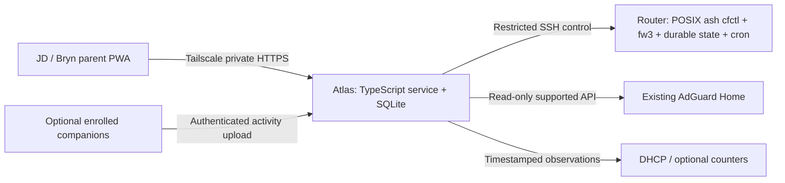

# Couvre-feu — full application roadmap

Status: **historical planning proposal; bounded router-core execution and public PR workflow subsequently approved**. The current authorization covers local core development, fixtures, review and the public repository/PR workflow. Later product phases and deployment remain unapproved. Every router action still requires separate approval of its exact script, target and rollback. Standalone Couvre-feu is the selected product; Fengard may inform design, with attribution and license review if code is reused.

## Evidence and product scope

- The original [PRP-001](../../docs/prp/PRP-001-enforcement-core.md) covers enforcement and the policy service; it explicitly reserves **PRP-002 for the parent PWA**. Its enforcement acceptance targets remain the baseline, subject to corrections below [PRP-001:94–104].
- The [spike](../../docs/spike-001.md) completed inspection only and prohibits further SSH or enforcement implementation under that authorization. Loaded primitives and hook ordering are evidence, not working enforcement [spike:13–16,34–47].
- Planning-time snapshot: the project initially contained the spike without application source and had an uninitialized/read-only Git directory. That snapshot is historical. A bounded router-core implementation and public `bearyjd/couvre-feu` repository/PR workflow were subsequently authorized; current code and PR evidence are tracked separately. Later service/PWA, enrollment, deployment and router actions remain outside that authorization.
- The requested product includes person/device controls, schedules, estimated network use, domains, devices, alerts, and later optional companion software for richer app/site activity. Router observations and device activity remain separate datasets with visible provenance.
- The children's platforms are **Android, ChromeOS, iOS and Windows**. OS versions, browser support, device management and consent remain to inventory. Proposed companion priority is Android and Windows first; ChromeOS starts with browser-extension coverage and a separate broader-app feasibility spike; iOS remains entitlement/privacy-gated.

## Feature matrix

| Capability | First usable release: stages 1–2 | Planned expansion and dependency |
|---|---|---|
| People/devices | Assign several MACs to a person; labels; JD protected devices; safe pause/resume | Stage 3 timestamped discovery and attribution; unknown devices visible to JD, never quarantined |
| Parent controls | Immediate pause; timed pause; resume; router-confirmed status; supported schedules | Stage 4 temporary schedule bypass, bonuses, requests and richer schedule editing after expiry/schedule gate |
| Device inventory | Assigned devices, last confirmed enforcement, router reachability | Stage 3 lease freshness, observed addresses, last network activity and confidence |
| Activity/usage | Honest unavailable states; no invented measurements | Stage 3 recent network activity, DNS domains and optional estimated byte totals; stage 5 OS-qualified app/site activity |
| Alerts | In-app drift/error status and operational audit | Stage 3 actionable alerts; stage 4 approved delivery channels, deduplication and preferences |
| App/access | Phone-friendly PWA; JD admin and Bryn parent; passkeys; private HTTPS | Stage 4 Web Push where supported; stage 5 enrolled companion clients |
| Reliability | Core rollback, durable router state, confirmation, service backups | Each stage adds failure tests; stage 6 release/recovery packaging and signed companion updates |
| Filtering | Existing AdGuard Home/NextDNS remains responsible | Optional separately scoped, reversible AGH API integration; no custom CA, VPN takeover or unknown-device quarantine |

## Proposed architecture and boundaries

- Router enforcement has no daemon, SQLite, telemetry agent, or PWA dependency. Use POSIX ash and existing fw3/iptables; isolate backend functions for a future fw4 migration. Never alter dnsmasq or WAN configuration.
- Atlas hosts `service/`, `web/`, and `shared/` (all **proposed paths**), SQLite and Podman. Tailscale Serve provides private HTTPS; bind the application listener to loopback and verify the supported Serve configuration. [Official Serve documentation](https://tailscale.com/docs/features/tailscale-serve).
- Choose the final private HTTPS hostname before enrolling passkeys. Preserve its WebAuthn RP ID/origin through deployment and recovery; validate origin, RP ID, challenge and user verification server-side. [WebAuthn specification](https://www.w3.org/TR/webauthn-2/).
- JD is admin: enrollment, device assignment, schedules, diagnostics and configuration. Bryn is parent: assigned-person status and controls. Define whether schedule editing is admin-only before PRP-002 implementation. Enforce roles on APIs, not only in navigation.
- Service is the desired-policy authority; router is the observed-enforcement authority. Persist desired revision, observed revision, operation ID, last successful confirmation, timestamps and errors. Show pending, stale, unreachable and failed states distinctly.
- Synchronous writes return HTTP 200 only after matching router post-apply confirmation; if asynchronous processing is chosen, return 202 with operation/status tracking. Timeout is unknown/pending until reconciled, never success. Idempotency keys and revision preconditions prevent duplicate grants and stale edits.
- Serialize router mutations, validate bounded input without shell evaluation, and audit actor, request, desired revision and router outcome. The restricted SSH wrapper accepts only explicit operations and cannot become a general shell [PRP-001:76–78; spike:71–72].
- An offline PWA may cache clearly timestamped status but cannot queue blind policy mutations. Reconnection requires refreshed state and an explicit user action. Optional companions may buffer bounded activity, never enforcement commands.

## Required design corrections and invariant safety rules

1. **Protect the parent and current control client on every attempt.** Persist a protected-MAC list available to SSH, cron and firewall-include execution. Resolve and validate the current SSH client's identity before each controlling operation; abort safely if unresolved, protected membership overlaps a target, or safety inputs are invalid. The locally captured unique SSH-client IP-to-MAC mapping is only a candidate [spike:75], not durable proof. Establish how noninteractive cron/include paths validate persisted protection without an SSH environment; never interpret missing identity as permission to block.
2. **Rollback precedes install.** Define ownership of every `cf_*` object and record exact original files, UCI values, absent paths and authorized-key contents/permissions, including firewall and sysupgrade configuration. Test uninstall/restoration first against fixtures. Detect changes since installation before restoration: on drift, refuse destructive restore, preserve and report the changed configuration, and require explicit resolution before restoring the exact recorded originals. No best-effort substitute or blanket restoration may erase unrelated changes. Stage a recoverable installer, validate before activation, preserve originals, and document recovery from a partial install.
3. **Established traffic requires early enforcement.** `forwarding_rule` precedes established acceptance, while zone-level schedule rejects follow it [spike:34–43]. Add and verify an early schedule mirror/current-policy decision. This is an explicit PRP-001 deviation; native zone schedules alone do not guarantee stopping an existing stream. The claim that broken `cfctl` leaves all schedule enforcement intact is withdrawn pending demonstrated behavior [PRP-001:57,85].
4. **Resolve bonus versus native-rule conflict before offering bonuses.** An unconditional native schedule REJECT can defeat an early “allow” that merely returns to later chains. Choose a narrowly scoped, protected, testable schedule-bypass mechanism or revise native rules; document residual behavior when helpers fail. Do not bypass unrelated GL/security rules with a broad ACCEPT.
5. **Policy precedence:** explicit manual pause wins over bonus/schedule bypass; otherwise an active “Allow until” bypasses the schedule; otherwise the current schedule applies. Resume removes only manual pause. A bonus adds elapsed wall-clock allowance, never measured screen-time minutes; define grant replacement/extension, limits and clock correction behavior before shipping it.
6. **Expiry lives on the router.** Durable overrides and local re-evaluation of the current schedule work without Atlas. Expiry must discard stale overrides, survive reboot and be idempotent; reconnect reconciliation must not resurrect an expired grant. Use explicit tombstones/revisions or equivalent ordering. Document cron precision and boundary latency instead of promising second-level expiry.
7. **IPv6 closure is unproven.** The snapshot shows disabled LAN RA/DHCPv6, not permanent disablement [spike:51–53]. Validate IPv6 rules and prefix/reboot behavior; stop release if an unsupported path can bypass policy. Do not treat blanket LAN/WAN changes as authorized fallback.
8. **DNS integration requires a separate gate.** Kids-only redirection must account for GL UDP mark-based INPUT drops and preserve adults [spike:63–67]. Determine listener ownership and AGH health before integration. DoH IP lists provide limited bypass resistance; cellular, VPNs, shared-IP endpoints and encrypted DNS cannot be universally controlled [PRP-001:118].
9. **Cutoff and persistence are measured.** Validate conntrack executable availability, current-address resolution, acceleration/offload, include ordering, cron, reload/reboot and sysupgrade preservation [spike:16,45–47,73–74]. File preservation alone does not guarantee firmware compatibility; fail visibly on unsupported firmware rather than silently applying stale rules.

## Staged delivery and acceptance gates

### Stage 0 — corrected design, inventory and separately approved spikes

Produce a revised enforcement specification, policy truth table, current/supported firmware matrix, installer/uninstaller design, restricted-SSH grammar, protected-client rules and router/service revision contract. Resolve timezone spelling/configuration, cross-midnight windows, DST transitions, clock jumps and matching semantics before schedule code. Inventory the children's platforms and settle parent/admin permissions.

Propose small exact-script inspections for unresolved firmware, executable, timezone, include, offload, DNS owner/marks, AGH API/version and protected identities. Runtime key, DNS, IPv6 and packet tests are separate approved actions; the external cellular DNS timeout remains pending [spike:79–85]. No automatic disabling of GL parental controls or modification of existing services.

Acceptance: user approves the revised design and subsequent implementation scope; reviewer identifies no unresolved contradiction that would compromise protection, existing-session cutoff, expiry or DNS safety. Each unresolved capability has a bounded spike and stop condition. No router action follows from roadmap approval alone.

### Stage 1 — router enforcement core and recovery

Proposed deliverables preserve `router/cfctl` with `status --json`, `pause [--until <epoch>]`, `resume`, `expire`, `apply-fw` and `sync`; `router/cfctl-ssh`; firewall include and cron integration; installer/uninstaller; fixtures; `tests/acceptance.sh`; `docs/acceptance-001.md`; README; and a reviewable PR description recording known gaps and PRP deviations. Implement atomic durable state, locking, bounded schema validation, protected identities, pause/resume, early schedule enforcement, local expiry, idempotent firewall integration and confined control key. Preserve no-daemon constraints. Known DoH rules follow only after the DNS integration gate is cleared.

Acceptance, locally first: mock firewall/UCI/SSH tests cover protected-MAC refusal, unresolved SSH identity, invalid input/command injection, apply failure, partial install, exact uninstall, duplicate sync, reboot reconstruction, cron/include protection, expired/stale revisions and schedule boundaries. Test established-flow logic rather than merely checking generated text. Produce a reviewable installer plus recovery instructions.

Before live tests, collect real isolated fw3/iptables/ipset/conntrack integration evidence, or use a disposable compatible OpenWrt environment: an established flow crosses schedule start and stops; pause/resume works; router-local cron expiry applies the current schedule; firewall reload reconstructs state; and a protected adult remains unaffected. Mocks alone cannot satisfy this gate. If a compatible environment is unavailable, mark integration acceptance pending and do not advance to live testing. When bonuses are implemented, the native-rule/bypass interaction must pass this same integration gate before release.

Later, separately approved live acceptance uses **one explicit test MAC** and exact scripts: existing IPv4/IPv6 streams stop within the PRP's 5-second target where supported; adults retain DNS/access; service-off expiry restores the correct current schedule within declared cron tolerance; reload/reboot restore intended policy; restricted key cannot obtain shell/forwarding. Firmware upgrade testing requires separate approval and recovery readiness. Failure keeps the stage incomplete.

### Stage 2 — service control API and usable parent PWA

Proposed `service/` modules: auth, roles, policy, router client, reconciliation, operations and audit; `shared/` holds schemas/contracts; `web/` holds PWA views. SQLite migrations and backup restoration are part of this stage. Build person/device setup, immediate/timed pause, resume, supported schedules, last-confirmed status and useful error recovery. Service startup reconciles without replaying obsolete overrides.

Proposed API routes: `GET /people`, `GET /devices`, `GET /operations/:id`, `POST /people/:id/pause`, `POST /people/:id/resume`, and revision-checked admin device/schedule routes. These are design proposals, not existing endpoints. Delay `/bonus` until stage 4 passes its design gate. UI distinguishes a schedule block from manual pause, so resume is not misleading. Enforce disjoint person-to-MAC assignment; shared devices need an explicit household policy/owner rather than inferred user identity.

Acceptance: JD and Bryn complete their allowed flows on phones over private HTTPS; unauthorized roles are rejected; 200/202/error semantics match actual router outcome; retries cannot double-apply; competing edits are explicit; Atlas downtime leaves router policy functioning; a disconnected PWA cannot silently apply old changes. Test passkey enrollment/recovery, session handling, stable origin, database restore and migration failure. This is the first usable release, with telemetry explicitly unavailable until stage 3.

### Stage 3 — network activity, domains, estimated usage and alerts

Proposed `service/telemetry/` modules read the installed AGH version's supported querylog/stats API, lease snapshots and optional counters. Init-enabled AGH is the only currently established fact; running state, process ownership, querylog enablement and retention remain unknown [spike:57]. Discover the installed API/version and read existing configuration. Enabling query logging or changing retention requires explicit consent and a separately approved reversible action. [AGH OpenAPI reference](https://github.com/AdguardTeam/AdGuardHome/blob/master/openapi/openapi.yaml).

Store timestamped IP↔MAC↔person attribution intervals, source, confidence and observed freshness. Address reuse, IPv6 privacy addresses, resolver caching, private MAC rotation, shared devices and missing logs produce unknown/partial attribution. Never label old IP matches as certain or display unrelated household domains to a parent. Domain queries show network requests, not proof a person visited or actively used a site; no decrypted URLs are collected.

Offer recent network activity, domain summaries/query counts and alerts for router unreachable, sync drift/failure, unassigned devices and unavailable collectors. Byte totals are optional estimates only after demonstrating existing accounting availability and offload coverage; avoid double counting interfaces/connections. Do not silently enable kernel accounting or change offload. [Conntrack accounting reference](https://conntrack-tools.netfilter.org/manual.html).

Acceptance: replay fixtures cover IP reassignment, missing leases, rotating MACs, multiple addresses and collector downtime; every metric carries provenance/time range/coverage; DNS counts and bytes are never converted into true screen time; stale/unknown states render honestly. Compare available byte estimates against a controlled transfer under separately approved testing. Alerts deduplicate and recover; default payloads omit sensitive domains.

### Stage 4 — richer controls and notification delivery

Add “Allow until,” bounded wall-clock bonus grants, schedule templates/exceptions and parent-friendly editing only after stage 0's native-rule conflict and stage 1's router-local expiry model are proven. Define limits and audit all grant changes. Notifications can use approved ntfy settings and/or PWA Web Push with explicit subscriptions, private payloads and rate limits. iOS/iPadOS Web Push requires a Home Screen app on 16.4+ and permission requested from a user action. [WebKit requirements](https://webkit.org/blog/13878/web-push-for-web-apps-on-ios-and-ipados/).

Optional later child view shows collection/coverage, current restrictions and an “Allow until” countdown, and can request extra time. Parent approval/denial is audited; a request never automatically grants access. Any future time budget must define its measurement basis and concurrency before being offered; network estimates cannot spend a screen-time budget.

Acceptance: truth-table and service-down tests cover manual pause during a bonus, resume during a blocked schedule, bonus expiry during a blocked/allowed schedule, DST/clock changes, reboot and stale reconciliation. UI describes wall-clock allowance accurately. Notification preference, unsubscribe and unavailable-platform behavior work without making enforcement depend on delivery.

### Stage 5 — optional companions, selected through capability spikes

Define enrollment/revocation, per-device credentials, signed updates, bounded offline buffering, consent, local retention and upload scopes first. Companions report activity independently; router enforcement continues if absent or stopped. Do not claim tamperproof measurement on an unmanaged device. No keystrokes, screenshots, custom CA or decrypted URL interception.

Per-app restrictions and controls outside the home network are optional future OS-specific capabilities, separately permissioned and validated from monitoring. They require their own design/entitlement gates and do not follow automatically from collecting app activity.

| Candidate | Capability to validate | Limits and release gate |
|---|---|---|
| Windows desktop; macOS optional future scope | Foreground app plus idle/session state; aggregate active intervals | Sleep, multiple users and idle are explicit; APIs identify foreground apps, not website history. [Windows](https://learn.microsoft.com/en-us/windows/win32/api/winuser/nf-winuser-getforegroundwindow), [macOS](https://developer.apple.com/documentation/appkit/nsworkspace/frontmostapplication) |
| ChromeOS/browser extension | Focused active-tab domain intervals, permission-scoped and consented | ChromeOS browser coverage is distinct from Android/Linux/system app coverage, which needs a separate capability spike. Account for idle/background tabs and private mode; exclude URL paths/query strings by default. [Chrome tabs API](https://developer.chrome.com/docs/extensions/reference/api/tabs) |
| Android | UsageStats app events/aggregates with user-granted settings access | No URL-history promise; permission revocation and OS limits are visible. WorkManager periodic work has a 15-minute minimum and may be delayed. [UsageStats](https://developer.android.com/reference/android/app/usage/UsageStatsManager), [WorkManager](https://developer.android.com/reference/androidx/work/PeriodicWorkRequest) |
| iPhone/iPad | Screen Time/FamilyControls feasibility, parental enrollment and on-device reporting | Distribution entitlement is required; DeviceActivity report extensions restrict network/content export. No promise of centralized arbitrary iOS app/site history. [Entitlement](https://developer.apple.com/documentation/familycontrols/requesting-the-family-controls-entitlement), [Report privacy](https://developer.apple.com/documentation/deviceactivity/deviceactivityreport) |

Acceptance: choose platforms only after inventory and runnable capability evidence; document each granted permission, available event type, latency and unsupported state. Verify revocation stops ingestion and removes credentials. Keep app, browser and network timelines distinct; deduplicate overlap where demonstrated and never sum overlapping sources/devices into “screen time.” Unsupported Apple central telemetry remains unavailable unless official permitted APIs and a successful entitlement path establish otherwise.

### Stage 6 — release readiness and ongoing recovery

Finish deployment/recovery runbooks, versioned migrations and export, encrypted service backups with tested restore, router original-config preservation/uninstall, passkey/account recovery, private hostname recovery, dependency updates, supported-firmware checks and bounded storage. Sign and verify companion installers/updates when companions exist; revoke compromised devices independently of parent access. Hardening occurs in every stage, with final end-to-end rehearsal here.

Acceptance: restore a clean Atlas instance and recover authentication/router synchronization without stale overrides; demonstrate safe router uninstall using exact originals; enforce retention deletion and backup lifecycle; rehearse collector outage, expired companion credentials and upgrade rollback. Security reviewer/verifier evidence is separate from the implementation pass. Production router/deployment steps still require their own approvals.

## Privacy, dependencies and spec split

- Proposed defaults: **7 days raw observations, 30 days daily aggregates**, user-tunable after a storage/privacy decision. Do not assume the existing AGH log policy matches these defaults; document whether deletion covers app imports, source logs and backups. Define audit retention separately for control/recovery needs, with minimal identifiers and no domain payloads. JD diagnostics and Bryn access remain scoped; sensitive activity collection is opt-in where appropriate.
- Dependency order: protected identity/rollback + early hooks → core; confirmed API/auth → PWA; AGH/version/attribution → telemetry; local expiry + native-schedule conflict resolution → bonuses; device inventory/permissions/entitlements → companions. Stage 3 telemetry and stage 5 capability research may proceed independently after separately approved scopes; neither blocks core router enforcement.
- Primary risks: self-lockout, offload bypass, future IPv6, DNS mark conflicts, clock/DST behavior, randomized identities, restricted-key limitations, firmware migration, telemetry misattribution, passkey hostname changes and platform privacy restrictions. Each has an explicit stage gate; unsupported capabilities remain visible rather than optimistic.
- Preserve **PRP-001 enforcement core**, documenting the service extraction and all schedule/DNS/safety deviations. Preserve **PRP-002 parent PWA**. Propose **PRP-003 policy service/API/auth**, **PRP-004 network telemetry/privacy**, **PRP-005 richer policies/notifications**, **PRP-006 companions** with platform annexes, and **PRP-007 release/recovery**. These numbers beyond 002 are proposed; no specifications are silently overwritten.
- Approval order: this roadmap and capability expectations → corrected PRPs/stage plans → implementation within the approved scope → separate exact-script inspection/live router approvals → separate deployment approval. No source implementation begins before plan approval.
